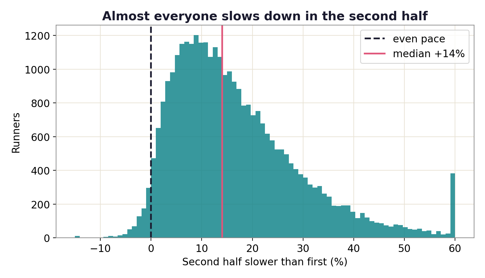

# The Negative-Split Myth

How many marathoners run the second half faster than the first? I counted every one of the 31,912 finishers of the 2014 Boston Marathon, and 2.5% did.

[Live site](https://lyhjeremy.github.io/marathon-negative-split-myth/) · [Write-up](https://lyhjeremy.github.io/marathon-negative-split-myth/overview/)

Design and copy follow [these standards](https://github.com/lyhjeremy/lyhjeremy/blob/main/DESIGN_STANDARDS.md).

## Results

- 2.5% of finishers (803 of 31,912) ran a negative split. Another 3.9% finished within 2% of even, and 93.6% slowed by more than that.
- The median second half was 14.0% slower than the first.
- Fade tracks ability: a median 5.3% slowdown for sub-3-hour finishers against 21.7% for runners over 4 hours.
- Women slowed slightly less than men, 13.4% against 14.8%.



## Method

Each runner's race is split at the half-marathon timing mat. First half is the half split; second half is official finish time minus the half split. The ratio second / first above 1 means the runner slowed. A ratio below 1 is a negative split, and 1.00 to 1.02 counts as even.

The analysis is descriptive: shares and medians over the full field, then medians grouped by finish-time band (2:00 to 6:00 in half-hour steps, 5:00 to 6:00 as one band) and by gender. Every finisher is counted and nothing is modeled, so the numbers are exact for this race.

Stack: Python, pandas, NumPy, matplotlib.

## How to run

```bash
pip install -r requirements.txt
python fetch_data.py     # downloads 2014 Boston results to data/
python analyze.py        # writes figures/ and tables/summary.csv
```

## Repo layout

| Path | Contents |
|---|---|
| `fetch_data.py` | Downloads the results CSV into `data/` (git-ignored) |
| `analyze.py` | Computes the splits, writes four figures and the summary table |
| `figures/` | Slowdown histogram, pacing categories, slowdown by finish band, by gender |
| `tables/summary.csv` | Headline numbers |
| `index.html`, `overview/` | The GitHub Pages site |
| `writeup.md` | Short write-up |

## Data

Official 2014 Boston Marathon results from the public mirror [llimllib/bostonmarathon](https://github.com/llimllib/bostonmarathon). Split columns are cumulative times in decimal minutes.

## Limitations

This is one race on one course. Boston drops early and puts its hills between miles 16 and 21, which makes an even split harder than on a flat course, and its qualified field is faster than a typical marathon's. The halfway mat is the only checkpoint used, and weather is not modeled. The pacing-categories chart (`figures/02_split_categories.png`) counts "even" as within 2% either side, so its negative-split bar reads 1.5%; the headline rule (ratio below 1) gives 2.5%.

## License

[MIT](LICENSE) © 2026 Jeremy Lee
